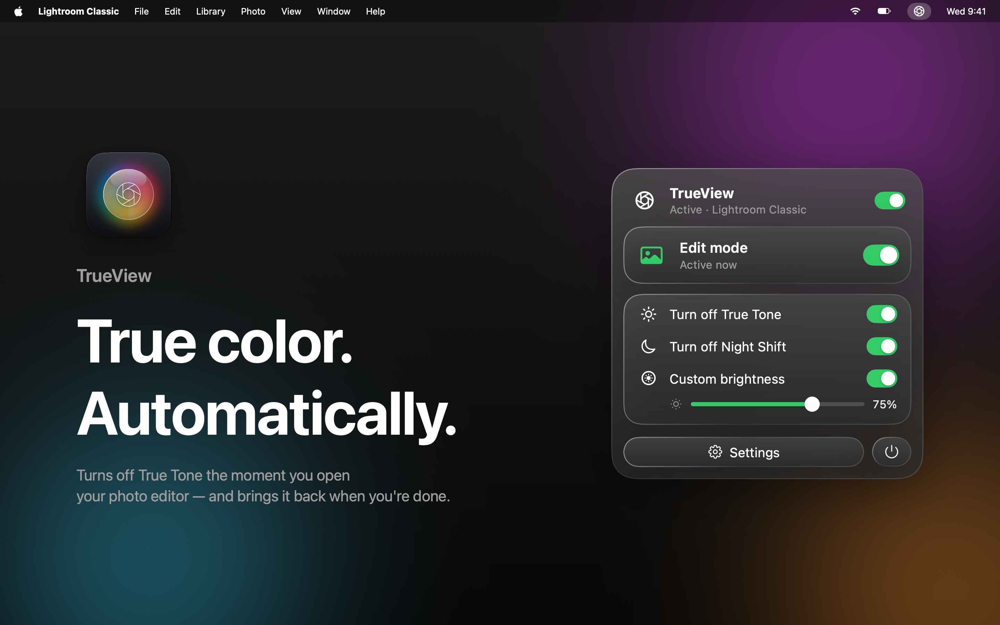
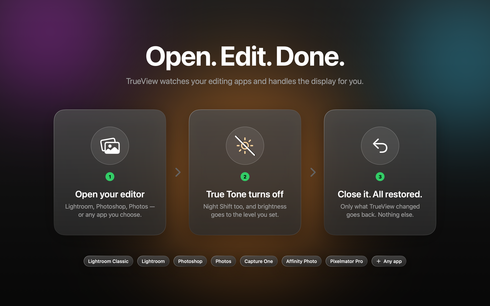
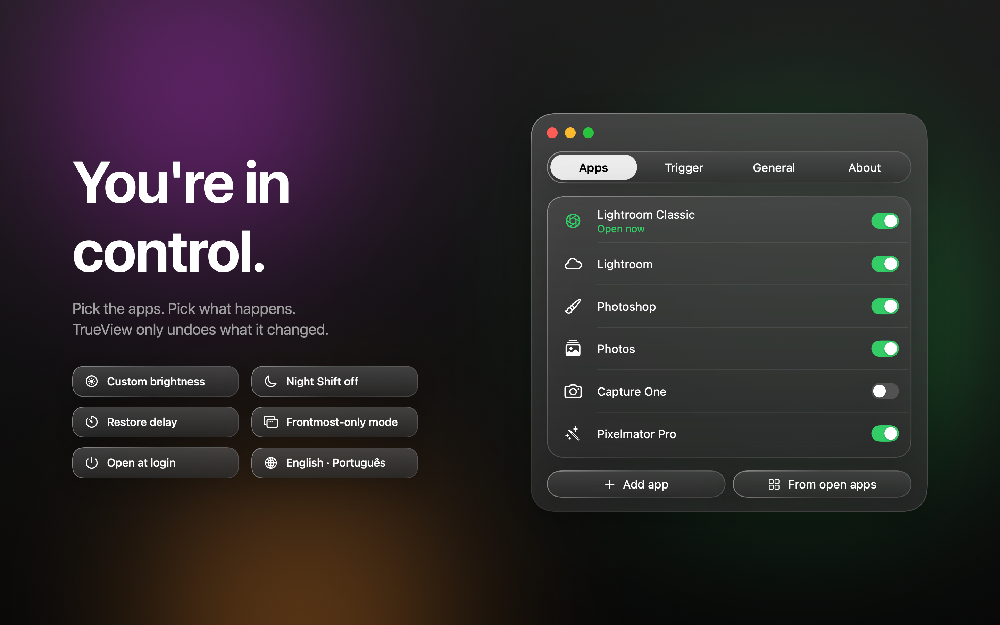

# TrueView



App de barra de menus para macOS que desliga o **True Tone** (e o Night Shift) automaticamente quando você abre apps de edição de imagem — Lightroom Classic, Lightroom, Photoshop, Fotos, Capture One etc. — e restaura tudo quando eles fecham.

## Screenshots






## Funcionalidades

- Monitora a abertura/fechamento (ou o primeiro plano) dos apps escolhidos
- Desliga True Tone e Night Shift no "modo edição"
- Brilho personalizado da tela interna, com volta ao brilho anterior
- Restaura só o que o app mudou; se o True Tone já estava desligado, continua desligado
- Espera configurável antes de restaurar (evita a tela piscar ao trocar de app)
- Recupera o estado da tela se o app for encerrado à força
- Lista de apps configurável (adicionar pela pasta Aplicativos, pelos apps abertos ou arrastando)
- Abrir ao iniciar sessão, notificações, idioma Português/English
- Interface em Liquid Glass

## Requisitos

- macOS 26 ou mais recente, Apple Silicon
- Xcode Command Line Tools (`xcode-select --install`)

## Compilar

```bash
./build.sh
```

O app é gerado em `build/TrueView.app`. Copie para `/Applications`.

O ícone é desenhado em código (`Icon/IconRenderer.swift`); para regerar o `.icns`, rode o renderer e o `iconutil` (veja os comentários no arquivo).

As imagens promocionais também são geradas em código:

```bash
swiftc -O -swift-version 5 Promo/PromoRenderer.swift -o build/promo-render && build/promo-render
```

## Observação

True Tone, Night Shift e brilho são controlados por frameworks privados da Apple (`CoreBrightness`, `DisplayServices`), carregados em tempo de execução. Funcionam no macOS atual, mas podem mudar em futuras versões — por isso o app não é distribuível pela App Store.

---

Desenvolvido por Lucas Haliax
