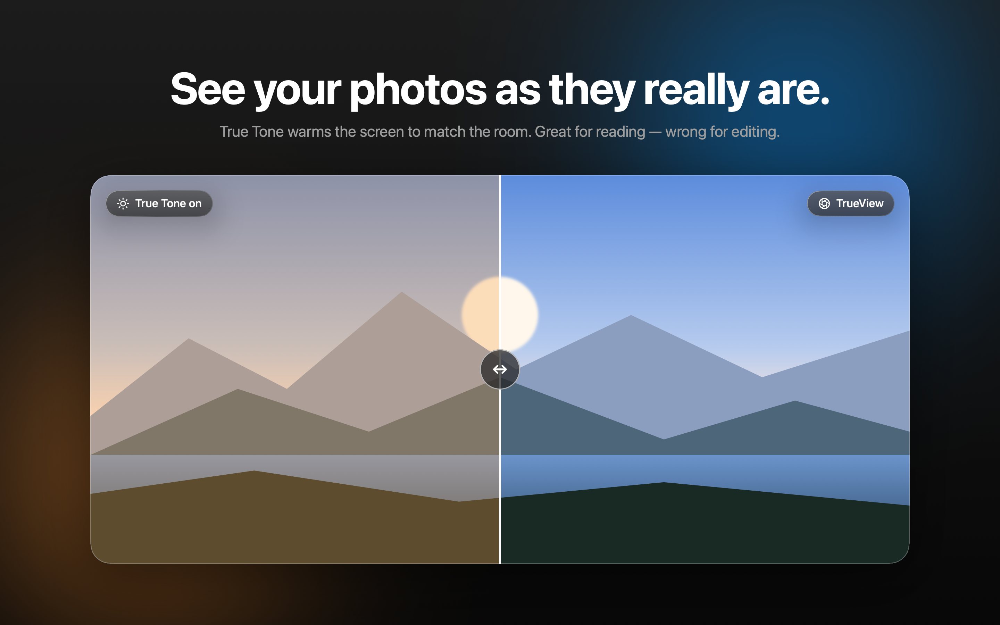

# TrueView

**English** · [Português](README.pt-BR.md)


A macOS menu bar app that automatically turns off **True Tone** (and Night Shift) when you open a photo editing app — Lightroom Classic, Lightroom, Photoshop, Photos, Capture One and more — and restores everything when you close it.

## Screenshots





## Features

- Watches when your chosen apps open and close (or come to the front)
- Turns off True Tone and Night Shift in "edit mode"
- Custom brightness for the built-in display, with a return to your previous level
- Only restores what it changed: if True Tone was already off, it stays off
- Adjustable delay before restoring, so the screen doesn't flicker when you switch apps
- Recovers the display state if the app is force-quit
- Configurable app list (add from Applications, from running apps, or by dragging)
- Open at login, notifications, English/Portuguese interface
- Liquid Glass interface

## Requirements

- macOS 26 or later, Apple Silicon
- Xcode Command Line Tools (`xcode-select --install`)

## Build

```bash
./build.sh
```

The app is built to `build/TrueView.app`. Copy it to `/Applications`.

The icon is drawn in code (`Icon/IconRenderer.swift`); to regenerate the `.icns`, run the renderer and then `iconutil`.

The promo images are generated in code too:

```bash
swiftc -O -swift-version 5 Promo/PromoRenderer.swift -o build/promo-render && build/promo-render
```

## Note

True Tone, Night Shift and brightness are controlled through private Apple frameworks (`CoreBrightness`, `DisplayServices`), loaded at runtime. They work on current macOS but may change in future versions — which is also why the app can't be distributed through the App Store.

---

Developed by Lucas Haliax
