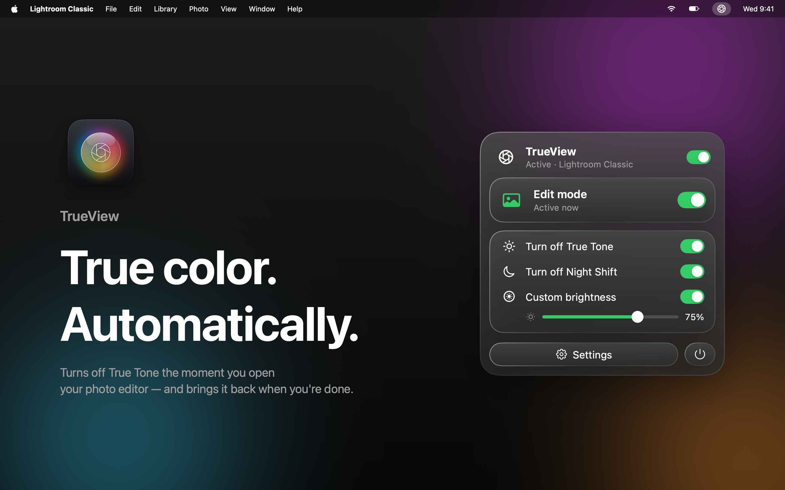
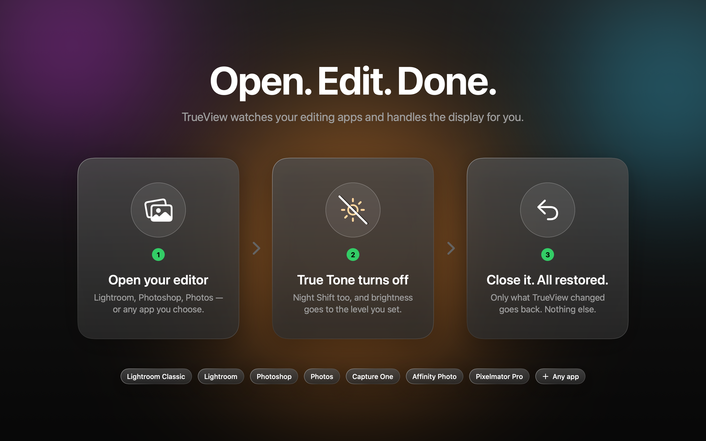
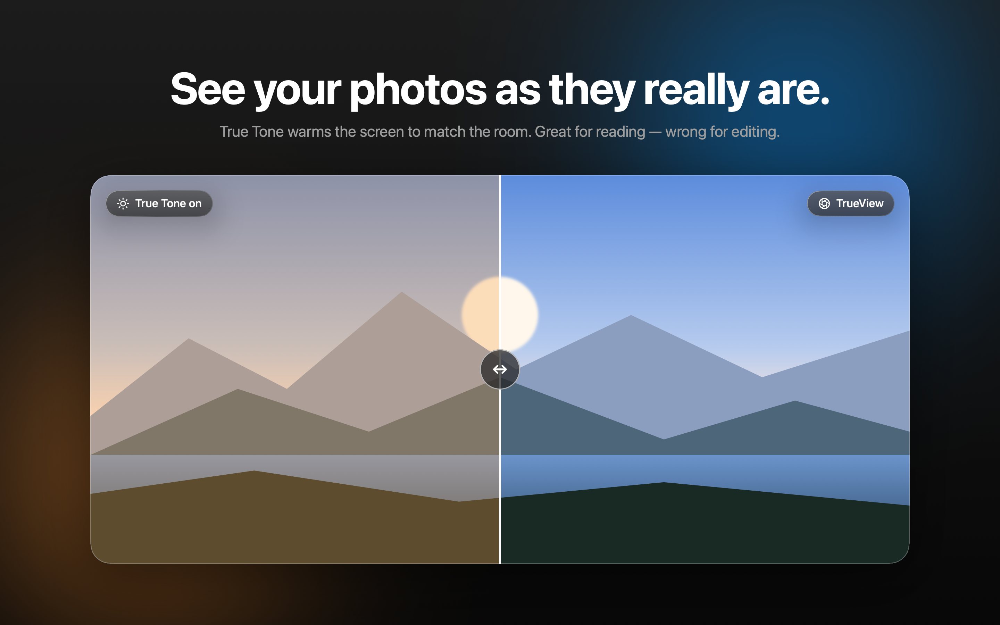
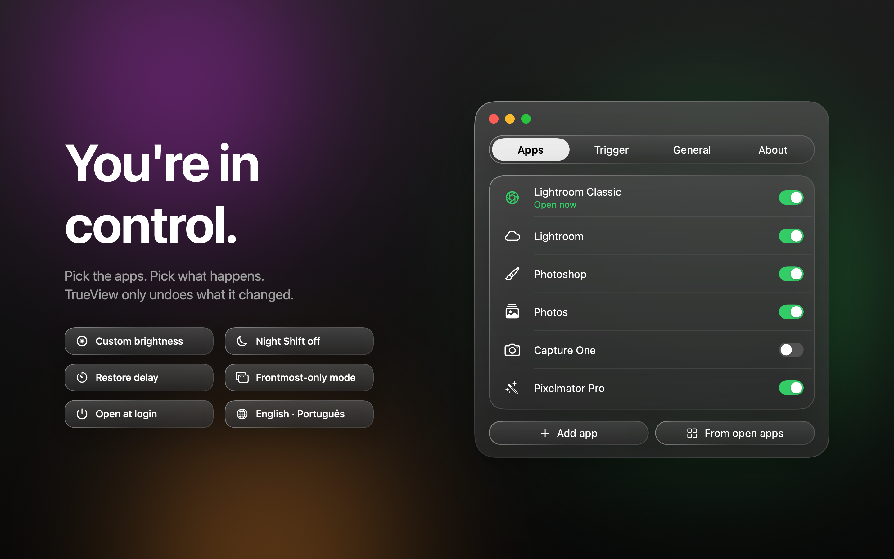

# TrueView

[English](README.md) · **Português**



App de barra de menus para macOS que desliga o **True Tone** (e o Night Shift) automaticamente quando você abre apps de edição de imagem — Lightroom Classic, Lightroom, Photoshop, Fotos, Capture One etc. — e restaura tudo quando eles fecham.

## Imagens







## Download

Baixe o **TrueView.zip** na [release mais recente](https://github.com/lucashaliax/TrueView/releases/latest), descompacte e arraste o `TrueView.app` para `/Applications` (Aplicativos).

O TrueView não é notarizado pela Apple, então o macOS bloqueia a primeira abertura. Para liberar:

1. Abra o TrueView uma vez. O macOS vai dizer que não pode verificar o desenvolvedor; clique em **OK**.
2. Vá em **Ajustes do Sistema → Privacidade e Segurança**, role até o fim e clique em **Abrir Mesmo Assim** ao lado do TrueView.

Ou rode isto uma vez no Terminal:

```bash
xattr -dr com.apple.quarantine /Applications/TrueView.app
```

## Funcionalidades

- Monitora a abertura/fechamento (ou o primeiro plano) dos apps escolhidos
- Desliga True Tone e Night Shift no "modo edição"
- Brilho personalizado da tela interna, com volta ao brilho anterior
- Restaura só o que o app mudou; se o True Tone já estava desligado, continua desligado
- Espera configurável antes de restaurar (evita a tela piscar ao trocar de app)
- Recupera o estado da tela se o app for encerrado à força
- Lista de apps configurável (adicionar pela pasta Aplicativos, pelos apps abertos ou arrastando)
- Abrir ao iniciar sessão, notificações, idioma Português/English
- Atualiza sozinho: "Procurar atualizações" no Sobre (e uma verificação automática por dia) baixa o último release, verifica a assinatura e reabre o app
- Interface em Liquid Glass

## Requisitos

- macOS 26 ou mais recente, Apple Silicon
- Xcode Command Line Tools (`xcode-select --install`)

## Compilar o código

```bash
./build.sh          # compila, instala em /Applications, reabre e verifica o uso de recursos
./build.sh --zip    # o mesmo, e gera build/release/TrueView.zip para um release no GitHub
```

O app é gerado em `~/Library/Developer/TrueView-build` (fora de `~/Documents`, cuja sincronização com o iCloud quebra a assinatura) e assinado com o seu certificado Apple Development (`SIGN_ID` para escolher outra identidade). A assinatura com um time é o que permite ao atualizador conferir que a atualização vem do mesmo desenvolvedor. Todo build termina com `tools/check_resources.sh`, que mede memória, CPU em repouso, ativações e vazamentos.

O ícone é desenhado em código (`Icon/IconRenderer.swift`); para regerar o `.icns`, rode o renderer e o `iconutil` (veja os comentários no arquivo).

As imagens promocionais também são geradas em código:

```bash
swiftc -O -swift-version 5 Promo/PromoRenderer.swift -o build/promo-render && build/promo-render
```

## Observação

True Tone, Night Shift e brilho são controlados por frameworks privados da Apple (`CoreBrightness`, `DisplayServices`), carregados em tempo de execução. Funcionam no macOS atual, mas podem mudar em futuras versões — por isso o app não é distribuível pela App Store.

---

Desenvolvido por Lucas Haliax
